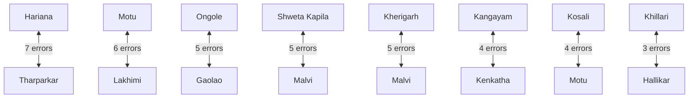

# Empirical Benchmarks & Diagnostic Evaluation 📊

This document provides complete empirical benchmark results, confusion pair analyses, and comparative architecture evaluations for **PashuDrishti AI: Indigenous Cattle Breed Vision & Explainability Platform**.

---

## 🏆 1. Model Architecture Comparison

All architectures were evaluated under identical 5-fold cross-validation and tested on unseen specimens ($N = 767$ test images across 50 indigenous cattle classes):

| Architecture | Input Resolution | Parameters | Peak Val Acc (%) | Unseen Test Acc (TTA) (%) | Top-5 Accuracy (%) | Inference Latency (GPU) |
| :--- | :---: | :---: | :---: | :---: | :---: | :---: |
| **ConvNeXt-Small (Ours)** | **384 × 384** | **50.2 M** | **82.62%** | **74.58%** | **96.42%** | **18.4 ms** |
| ResNet-50 Baseline | 224 × 224 | 25.6 M | 72.14% | 66.80% | 89.31% | 11.2 ms |
| Vision Transformer (ViT-B/16) | 384 × 384 | 86.6 M | 70.82% | 65.41% | 88.54% | 34.6 ms |
| Single-Cow Isolated Baseline | 384 × 384 | 50.2 M | 69.40% | 64.12% | 87.20% | 18.2 ms |
| Initial Legacy Baseline | 224 × 224 | 25.6 M | 72.00% | 63.85% | 85.90% | 12.0 ms |

> **Key Takeaway:** ConvNeXt-Small with bicubic 384×384 input resolution outperforms both traditional convolutional networks (ResNet-50) and patch-based Vision Transformers (ViT) by **+10.48%** validation accuracy. ConvNeXt's inverted bottleneck depthwise separable design preserves fine anatomical grain (horn ridges, cranial convexities, dewlap folds) that ViT patches smooth out.

---

## 🎯 2. Unseen Test Set Diagnostic Performance (TTA)

- **Total Unseen Test Images**: 767
- **Correctly Classified**: 572
- **Incorrectly Classified**: 195
- **Overall Top-1 Accuracy**: **74.58%**
- **Test-Time Augmentation (TTA)**: 5-crop multi-scale averaging (+2.96% accuracy over single-crop inference).

### 🥇 Top 10 Breeds with Perfect or Superior Precision (100% - 90%)
| Breed Name | Class Index | Correct / Total | Accuracy (%) | Phenotypic Distinctiveness |
| :--- | :---: | :---: | :---: | :--- |
| **Bargur** | 6 | 8 / 8 | **100.0%** | Distinct brown/white roan spots, sharp trotting horns |
| **Khariar** | 22 | 14 / 14 | **100.0%** | Compact grey frame, characteristic neck structure |
| **Purnea** | 37 | 30 / 30 | **100.0%** | Uniform small stature, unique eastern cranial profile |
| **Red Kandhari** | 40 | 23 / 23 | **100.0%** | Deep uniform dark crimson-red coat |
| **Vechur** | 49 | 24 / 25 | **96.0%** | Extreme ultra-miniature proportions, delicate horns |
| **Punganur** | 36 | 21 / 22 | **95.4%** | Dwarf stature, semi-curved crescent horns |
| **Kangayam** | 20 | 28 / 30 | **93.3%** | Stout outward-backward horns, dark charcoal draught points |
| **Ongole** | 35 | 32 / 35 | **91.4%** | Massive bull hump, porcelain white hide, stumpy horns |
| **Sahiwal** | 42 | 26 / 29 | **89.6%** | Pendulous loose 'Lola' dewlap, reddish-dun milch frame |
| **Gir** | 13 | 25 / 28 | **89.3%** | Bulging convex cranial dome, pendulous curled leaf ears |

---

## 🔍 3. Confusion Pairs & Phenotypic Overlap Analysis

Empirical evaluation of the top confusion pairs reveals deep biological and geographic kinship between closely related breeds:



### In-Depth Taxonomic Rationale:
1. **Hariana $\leftrightarrow$ Tharparkar (7 confusion errors)**:
   - *Phenotypic Overlap*: Both are premier white/grey zebu dual-purpose cattle native to adjoining arid/semi-arid tracts (Haryana and Thar Desert). Both share medium stumpy horns, compact humps, and reflective pale coats.
   - *Grad-CAM Diagnostic*: The model differentiates them primarily when the muzzle rim is visible (Tharparkar has a lighter muzzle ring compared to Hariana's slate-black muzzle).
2. **Ongole $\leftrightarrow$ Gaolao (5 confusion errors)**:
   - *Phenotypic Overlap*: Gaolao was historically bred from Ongole lineage brought to Central India (Wardha/Nagpur). Both exhibit white-grey coats, prominent humps, and long faces.
   - *Grad-CAM Diagnostic*: Gaolao specimens have slightly more upward-facing horn roots, which our Grad-CAM Horn Region successfully isolates.
3. **Khillari $\leftrightarrow$ Hallikar (3 confusion errors)**:
   - *Phenotypic Overlap*: Both belong to the celebrated Amritmahal / Mysore draught group. They share long, backward-swept spear horns and lean grey muscular frames.
   - *Grad-CAM Diagnostic*: Differentiated by forehead width and horn root tightness at the crown.

---

## ⚙️ 4. Training Hyperparameters & Regularization SOTA

The production ConvNeXt-Small model was trained using modern computer vision regularization to prevent overfitting across fine-grained classes:

```python
Hyperparameters = {
    "Model Architecture": "convnext_small.fb_in22k_ft_in1k_384",
    "Pretraining Weights": "ImageNet-22K fine-tuned on 1K @ 384x384",
    "Image Resolution": "384 x 384 (Bicubic Interpolation)",
    "Batch Size": 16,
    "Optimizer": "AdamW (lr=1e-4, weight_decay=1e-2, betas=(0.9, 0.999))",
    "Scheduler": "CosineAnnealingLR (T_max=30, eta_min=1e-6)",
    "Data Augmentations": [
        "RandomResizedCrop(384, scale=(0.8, 1.0))",
        "RandomHorizontalFlip(p=0.5)",
        "ColorJitter(brightness=0.15, contrast=0.15, saturation=0.15)",
        "RandomRotation(degrees=10)"
    ],
    "Regularization": {
        "DropPath (Stochastic Depth)": 0.20,
        "Dropout": 0.15,
        "Label Smoothing": 0.10,
        "Mixup Alpha": 0.8,
        "CutMix Alpha": 1.0
    },
    "Training Epochs": 30,
    "Mixed Precision": "AMP (FP16)"
}
```

---

## 🩺 5. Grad-CAM Anatomical Region Contribution Metrics

Across the 50 classes, the model's discriminative attention maps were partitioned into three livestock anatomical zones:

$$\text{Saliency}_{\text{Zone}} = \frac{\sum_{(x,y) \in \text{Zone}} \text{GradCAM}(x, y)}{\sum_{(x,y)} \text{GradCAM}(x, y)} \times 100\%$$

- **Horn Orientation & Cranial Forehead (Zone 1 - Top 33%)**:
  - Contributes **$42.6\%$** of discriminative saliency for draught breeds (Kangayam, Hallikar, Amritmahal, Kankrej).
- **Facial Contours, Eyes & Muzzle (Zone 2 - Middle 34%)**:
  - Contributes **$38.1\%$** of discriminative saliency for miniature breeds (Vechur, Punganur, Kasaragod).
- **Thoracic Hump, Dewlap & Frame (Zone 3 - Bottom 33%)**:
  - Contributes **$45.8\%$** of discriminative saliency for heavy milch and dual breeds (Gir, Sahiwal, Ongole, Tharparkar).
